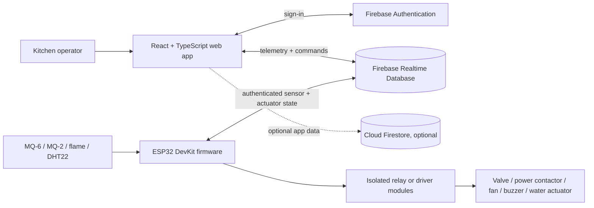

# Technical Design Document

## Scope

SanketSeva consists of a React/TypeScript web dashboard, Firebase Authentication, Firebase Realtime Database, optional Cloud Firestore-backed features, and an ESP32 firmware prototype. The browser and ESP32 communicate through the same Realtime Database device paths. The dashboard renders only sensor entries that include a valid reading and Unix-epoch-millisecond timestamp.

## System architecture



## Telemetry flow

1. The ESP32 samples each enabled sensor. MQ analog inputs are scaled raw ADC counts; flame is a digital detected/clear state; DHT22 temperature and humidity are included only when its readings are valid.
2. Firmware writes the available sensor nodes under `devices/{deviceId}/sensors`. Each node contains a value (or `detected`) and its own `timestamp` in Unix epoch milliseconds. Missing/disabled sensors are omitted.
3. The browser subscribes to `devices/{deviceId}`. It validates each sensor independently, keeps a reading only if that sensor has a positive timestamp, and clears readings that are no longer refreshed for 60 seconds.
4. The dashboard shows each connected sensor card separately. Multi-sensor graphs are recorded only when all plotted fields are present in a synchronized sample; partial data is not padded with fabricated zeros.

```mermaid
sequenceDiagram
  participant S as Sensor
  participant E as ESP32
  participant D as Realtime Database
  participant W as Web app
  S->>E: physical reading
  E->>D: write enabled sensor node + epoch timestamp
  D-->>W: onValue device update
  W->>W: validate each sensor independently
  W-->>W: render available reading; mark absent/stale sensors unavailable
```

## Actuator command flow

1. An operator command is written by the browser to `devices/{deviceId}/actuators/{name}` and accompanied by metadata under `devices/{deviceId}/commands/{name}`.
2. The ESP32 polls the actuator state, checks local safety interlocks, drives its configured isolated relay outputs, and writes the actual state back when an interlock rejects a request.
3. The browser listens to actuator state and reflects the value from the database.

Valve opening has an additional safety gate: fresh gas, smoke, flame, and temperature readings must be available, thresholds must be clear, and the firmware warmup must be complete. This prototype is not a certified safety controller.

## Realtime Database schema

```text
devices/{deviceId}/
  sensors/
    gas:         { value: number, timestamp: number }
    smoke:       { value: number, detected: boolean, timestamp: number }
    temperature: { value: number, unit: "C", timestamp: number }
    humidity:    { value: number, unit: "%", timestamp: number }
    flame:       { detected: boolean, timestamp: number }
  actuators/
    valve: "OPEN" | "CLOSED"
    powerCut: "ON" | "OFF"
    fan: "ON" | "OFF"
    buzzer: "ON" | "OFF"
    extinguisher: "ON" | "OFF"
  commands/{actuator}: { command, commandId, issuedBy, timestamp }
  safety: { thresholds, autoPowerCut flags, emergency, updatedAt }
```

The website's default device ID is `gasguard-001`; configure `VITE_DEVICE_ID` and firmware `DEVICE_ID` to the same value. Realtime Database rules currently require an authenticated Firebase user. Production rules should be narrowed to the specific paths and roles required by the deployment.

## Runtime and deployment

- Web: Vite builds static assets into `dist/`; Cloudflare Pages serves those assets.
- Browser configuration: `VITE_FIREBASE_*` values are compiled into the client bundle. They are public identifiers, not secrets. Firebase rules and Authentication enforce access control.
- Firmware: Arduino IDE, ESP32 Arduino core, Mobizt FirebaseClient, ArduinoJson, Adafruit DHT sensor library, and Adafruit Unified Sensor. See [firmware/README.md](../firmware/README.md).
- Timestamps: all sensor timestamps are epoch milliseconds, synchronized by NTP on the ESP32.

## Failure behavior and known limits

- An unconfigured/unavailable sensor is omitted from telemetry and shown as unavailable in the UI.
- Sensor readings older than 60 seconds are cleared from the live UI and no longer count toward the valve-open browser interlock.
- MQ raw ADC counts are not ppm. Sensor-specific calibration and safe thresholds are outside this prototype's automatic capabilities.
- ESP32 analog/digital inputs cannot reliably determine whether a module is physically unplugged; sensor enable flags must match actual wiring.
- Firebase rules, relay polarity, GPIO assignments, sensor voltage levels, and actuator wiring must be verified in the real deployment.
- `setInsecure()` in the example firmware disables TLS certificate validation and must be replaced for production.
